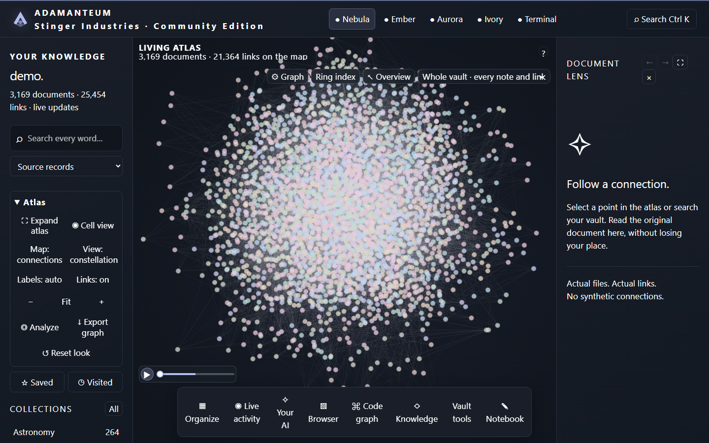
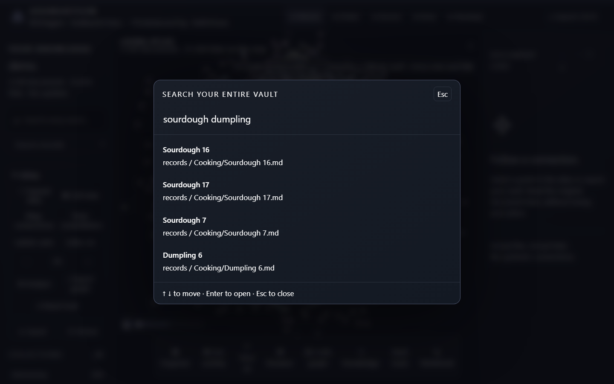
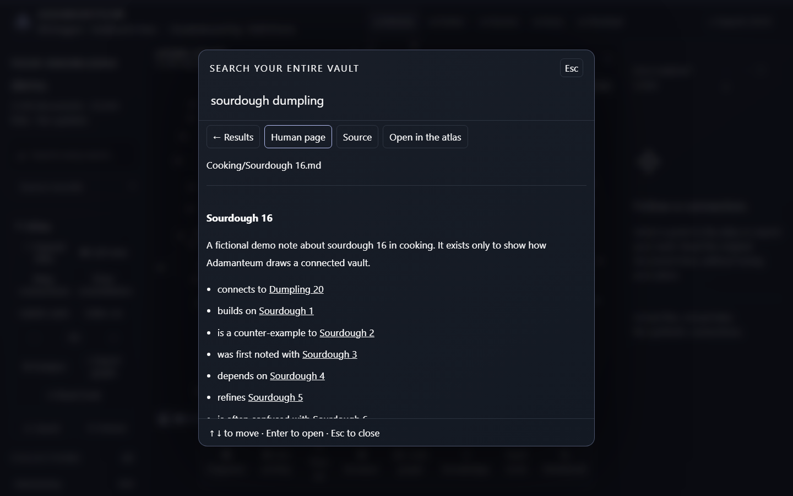
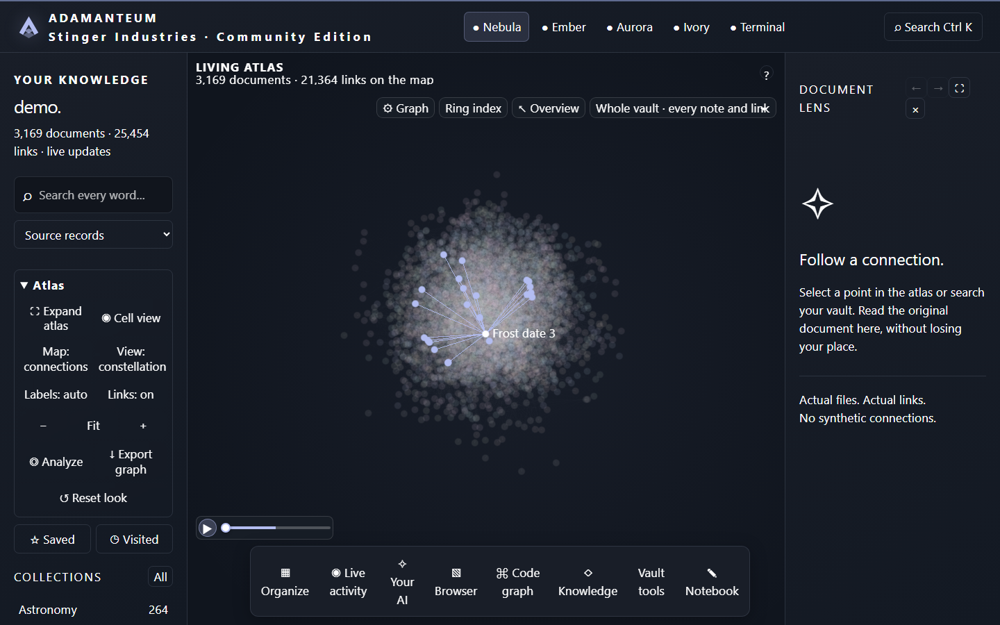

# Adamanteum Community Edition


**A knowledge atlas for people AND for AI.** You read, search and explore your notes and code; any AI reads the same vault through a safe door. Obsidian is built for the person. AI-only tools are built for the model. Adamanteum serves both.

**If this is useful, please star the repo. It is the one thing that helps other people find it.**



*Your whole vault as one living map. Each dot is a real note, each line a real link. (A fictional demo vault of 3,169 notes.)*

## What you get

- **The organic atlas.** Your vault drawn as a live, draggable map that settles as you move things. Nebula, Ember, Aurora and Ivory looks. It copes with large vaults because the layout runs in a worker.
- **Fast search over every word.** Quoted phrases, `-exclude`, `path:`, `file:`, `line:`, `OR`, filename-first ranking. Press Ctrl+K from anywhere.
- **Read without losing your place.** Open any result as the readable page or the raw source, in a side lens.
- **A notebook with revisions**, daily note, templates, and your own saved places.
- **A code graph** for 30 languages: functions, classes, calls and imports as a map you can query, trace and export. Your code is parsed, never run.
- **A door for AI.** Any AI that speaks MCP can search and read your vault. See "Bring your own AI".
- **Local-first.** Your notes stay on your machine. No account and no cloud service.

| Search across every word | Read the original, human page or source |
|---|---|
|  |  |



*Select a note and its real links light up.*

## Install and run (3 commands)

Install Node.js 24 or newer, then:

```sh
git clone https://github.com/ohhbeehave35-commits/adamanteum-community
cd adamanteum-community && npm ci --ignore-scripts
npm start
```

Open http://127.0.0.1:4173. It starts on 18 fictional sample notes. If the port is taken, set `PORT`.

To open your own Markdown folder, set `ADAMANTEUM_VAULT` to its absolute path (PowerShell: `$env:ADAMANTEUM_VAULT = 'D:/Notes'`), then `npm start`. Your original notes are read-only by default. Notebook revisions live in `.data/notebook.sqlite`; back up `.data` to keep the notebook, settings and indexes. Writing to your vault needs `ADAMANTEUM_VAULT_WRITE=1`. A Windows launcher with a folder picker is included (`Launch Adamanteum.cmd`).

## Bring your own AI

Adamanteum does not ship with an AI, and nothing leaves your computer unless you choose it. There are two ways to plug your own in.

**1. Put an AI inside Adamanteum** (the "Your AI" button at the bottom of the screen). Add a connection card:

```json
{ "schema": "adamanteum.ai/v1", "name": "My model", "model": "llama3.1", "endpoint": "http://127.0.0.1:11434/v1" }
```

Enter the API key, if there is one, in the box. Keys are held in memory, never written to a card. Any OpenAI-compatible endpoint works. Use HTTPS, or plain `http` only for something on your own machine:

| Model | Endpoint |
|---|---|
| Ollama (local) | `http://127.0.0.1:11434/v1` |
| LM Studio (local) | `http://127.0.0.1:1234/v1` |
| OpenAI | `https://api.openai.com/v1` |
| Any gateway or provider that speaks the OpenAI format (including Claude through such a gateway) | its `/v1` address |

Connect more than one and Adamanteum falls back to the next when a provider is down, out of credit or rate-limited, and remembers the dead one for 10 minutes (`failover.mjs`). Note text goes to your provider only when you click an action that says so.

**2. Let any AI read your vault through the door** (MCP). Mint a read-only token and print the config for your AI app:

```sh
node adamanteum-cli.mjs door mint my-ai --scope read --out ~/.adamanteum/door.token
node adamanteum-cli.mjs door mcp-config
```

Paste the printed `mcpServers` block into Claude Desktop, Cursor, Windsurf or any MCP client (Codex and Grok have one-line commands in the same output). The AI can then search and read your notes through `adamanteum_search` and related tools. **Any AI can read your vault**, yours stays in control: tokens are per AI and can be revoked (`door revoke`).

## Code graphs and exports

```sh
node adamanteum-cli.mjs scan /absolute/project --output graph.json
node adamanteum-cli.mjs query graph.json start
node adamanteum-cli.mjs export graph.json graph.graphml
```

Also: stats, path, affected, context, cluster, combine, notes, and import of Graphify JSON. 28 extra tree-sitter grammars sit beside JavaScript/TypeScript and Python. Python AST extraction needs Python 3 on PATH. Unresolved calls stay unresolved and inferred edges are labelled. Exports: JSON, GraphML, Markdown, Mermaid, JSON Canvas, SVG and offline HTML.

## Speed (measured, in our tests on one laptop)

Community Edition, 3 November 2026. A generated vault of 10,000 notes with 20,000 links, one Windows laptop, local server, median of 5 HTTP requests:

| Task | Time |
|---|---:|
| Index 10,000 notes from scratch | 10.4 s |
| Single-word search | about 3 ms |
| Quoted phrase search | about 3 ms |
| Filename search | about 3 ms |
| Three-word search | about 3 ms |
| Whole-graph response | 7 ms |

Earlier measurements (20 October 2026, version 0.3.2, a 221,995-document vault): single-word search 23 ms, note plus 84 links 16 ms, 562-file code graph 6.3 s, 1,000 Go/Rust/Java/C files scanned in 1.5 s, a 42,245-node Graphify graph imported in 1.5 s. Those are one-laptop observations, not a promise for your machine, and we did not re-run them for this release. We make no head-to-head speed claim against other tools.

## Not yet

- Editing notes in place with full Obsidian parity (the notebook is a separate store; optional vault editing is not full parity).
- Complete tags, properties and search-operator parity (basic tag controls exist; tags start off).
- Full embeds and transclusion (nested note embeds are incomplete).
- A full Canvas editor (import and export only).
- Complete cross-language call resolution. We do not claim verified semantic reasoning.

## Checks and licence

`npm test` runs the selected community tests; `npm run test:core` is the non-Python subset. `node verify/pubscan.mjs` scans the tree for private material (keys, personal paths, private hosts). See CHANGELOG.md.

MIT, copyright 2026 Ohh BeeHave LLC d/b/a Stinger Industries. Dependencies keep their own licences; see NOTICE. Made by [Stinger Industries](https://stingerindustriesai.com).
